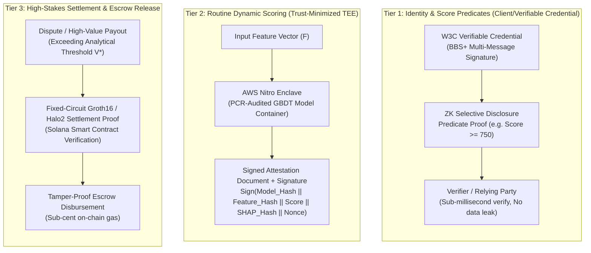
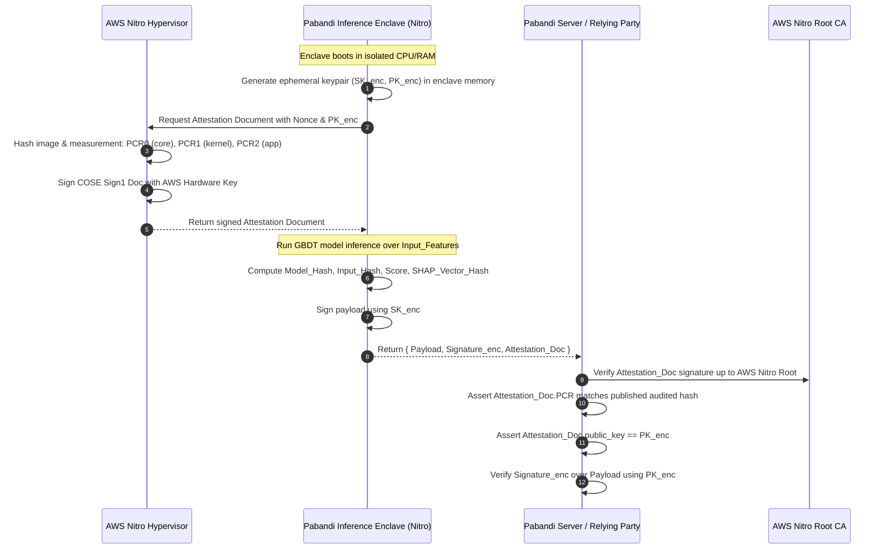
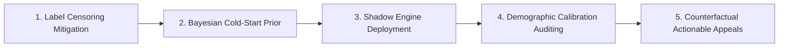

# Pabandi Trust, Verification & Privacy Architecture (v2.0)
## Implementation Specification: Three-Tier Attestation, Cryptographic Verification, and Governance

> **Executive Status:** Approved architectural revision addressing technical corrections on cryptographic primitives, TEE attestation verification, explainability commitments, and operational governance. Replaces the uniform per-inference zkML model with an economically optimized, tiered assurance framework.

---

## 1. Architectural Overview & Tiered Framework

Pabandi operates a hybrid trust engine spanning human service providers and autonomous AI agents. Rather than imposing prohibitive zkML proof generation costs (5–30s latency, \$0.05–\$0.50 per inference) across routine lookups, the platform matches cryptographic assurance level directly to economic risk:

### Performance & Cost Economics Matrix

| Metric | Tier 1: Predicate Proofs | Tier 2: Routine Enclave Inference | Tier 3: High-Stakes ZK Settlement |
| :--- | :--- | :--- | :--- |
| **Primary Mechanism** | BBS+ Signatures + ZK Predicates | AWS Nitro Enclaves Attested Execution | Fixed-Circuit Groth16 / Halo2 Proof |
| **Prover Latency** | 2 – 15 ms | 20 – 45 ms (GBDT inference) | 6 – 18 seconds |
| **Verification Latency** | < 5 ms (Client/Edge) | < 2 ms (ECDSA/Ed25519 verify) | < 12 ms (Solana On-Chain syscall) |
| **Operational Cost** | < \$0.00001 / query | ~ \$0.00008 / query | \$0.08 – \$0.35 / proof |
| **Data Leakage Risk** | Zero (Zero-Knowledge Disclosure) | Zero (Protected Enclave Memory) | Zero (Public input commitments only) |
| **Trust Assumption** | Cryptographic (BLS12-381 pairing) | Trust-minimized (Cloud Root CA + PCR) | Cryptographic (Soundness & Completeness) |

---

## 2. Technical Corrections & Cryptographic Primitives

### 2.1 Correction 1: BBS+ Signatures for Selective Attribute & Numeric Predicates
* **Deprecation:** Semaphore is completely dropped from the credential and score disclosure stack. Semaphore is an anonymous signaling and group-membership primitive; it cannot natively evaluate signed multi-attribute numeric inequalities (e.g., $\text{TrustScore} \ge 750$).
* **Adopted Primitive:** **BBS+ Signatures** (paired with Camenisch-Lysyanskaya / pairing-based proof-of-knowledge protocols over the BLS12-381 curve).
* **Specification:**
  1. The Pabandi Issuer signs a multi-message vector of trust attributes:
     $$m = \langle \text{SubjectDID}, \text{TrustScore}, \text{TrustBand}, \text{TotalEscrowsSettled}, \text{DisputeRatio}, \text{IssuedAt}, \text{Nonce} \rangle$$
  2. To prove eligibility to a counterparty or API gateway without revealing raw values, the holder creates a zero-knowledge proof of knowledge of a BBS+ signature:
     $$\pi = \text{ZKPoK}\left\{ (m, \sigma) : \text{VerifyBBS+}(\text{PK}_{\text{issuer}}, \sigma, m) = 1 \land m_{\text{TrustScore}} \ge 750 \land m_{\text{TrustBand}} = \text{'A'} \right\}$$
  3. The verifier confirms $\pi$ against $\text{PK}_{\text{issuer}}$ in sub-5ms without learning the subject's exact score, transaction count, or identity.

### 2.2 Correction 2: Proving System Topography & Trusted Setup Governance
* **Predicate Circuit Proving (Tier 1 & Dynamic Parameters):**
  * Avoids Groth16 for variable predicates to eliminate per-predicate trusted setup ceremonies.
  * Employs **Universal Structured Reference String (SRS)** architectures (Halo2 with KZG commitments or transparent IPA accumulator, and Marlin/PLONK).
  * A single multi-party computation (MPC) ceremony covers all polynomial degree requirements up to $2^{16}$ constraints, allowing arbitrary threshold parameters without new ceremonies.
* **Settlement Proving (Tier 3):**
  * **Groth16** is reserved *strictly* for the fixed, immutable Solana Escrow Settlement Circuit.
  * The circuit logic (verifying multi-milestone completion hashes, dispute arbitration consensus, and solvency balance equations) is static and deployed once to the Solana cluster via an immutable BPF program.
  * The trusted setup ceremony for this single circuit is executed via an open, verifiable Phase 2 ceremony with perpetual powers-of-tau public randomness.

---

## 3. TEE Attestation Chain & Posture

### 3.1 Explicit Attestation Chain Specification
A bare server signature $\text{Sign}_{\text{key}}(\text{Payload})$ represents only server identity, not execution integrity. Pabandi requires an unbroken hardware-grounded attestation chain:

### 3.2 Formal Payload Structure (Fixing the SHAP Binding Gap)
The inference output commits to both the output score and the explainability vector:

$$\text{Payload} = \text{Model}_{\text{IPFS\_Hash}} \parallel \text{Input\_Feature\_Hash} \parallel \text{Predicted\_Score} \parallel \text{SHAP\_Vector\_Hash} \parallel \text{Nonce} \parallel \text{Timestamp}$$

* **SHAP Vector Commitment:** $\text{SHAP\_Vector\_Hash} = \text{BLAKE3}(\text{shap}_1 \parallel \text{shap}_2 \parallel \dots \parallel \text{shap}_k)$.
* **Rationale:** Generating SNARK proofs for cooperative game-theoretic SHAP computations inside a circuit is computationally prohibitive. Committing to $\text{SHAP\_Vector\_Hash}$ guarantees that an inference node cannot alter the model explanation post-facto. If audited, tampering is cryptographically detectable with zero proof overhead.

### 3.3 Hardware Availability & Trust-Minimized Posture
* **Hardware Target:** Production target is **AWS Nitro Enclaves**. Intel SGX is formally recognized as obsolete for scalable production deployments due to deprecation on modern consumer hardware and strict enclave page cache (EPC) limitations.
* **Trust Posture Disclosure:** AWS Nitro is **trust-minimized, not trustless**. 
  * AWS controls the physical silicon, hypervisor firmware, and the Nitro Certificate Authority root keys.
  * Microarchitectural cache and transient-execution side channels remain theoretical vectors.
  * This is formally declared in all user and enterprise agreements as a bounded trust assumption: *users trust the cloud provider's physical isolation and the open-source reproducibility of the PCR2 image measurement, not Pabandi's internal operators.*

---

## 4. Operational Governance & Threshold Derivation

### 4.1 Resolution to Gap A: The Auditor's Data-Access Paradox
Auditing an inference requires evaluating $f(\text{Features}) \stackrel{?}{=} \text{Score}$ without publicly publishing confidential business features (e.g., bank deposits, phone identity, customer CRM deal notes).

Pabandi adopts a **Dual-Key Selective Disclosure Escrow** protocol:
1. **Auditor Accreditation:** Auditors are registered on-chain with accredited public encryption keys ($\text{PK}_{\text{Auditor}}$).
2. **Encrypted Evidence Anchoring:** During inference, the enclave produces an encrypted feature capsule:
   $$C = \text{HPKE}(\text{PK}_{\text{Auditor}}, \text{Features} \parallel \text{Salt})$$
   The hash $\text{SHA256}(C)$ is included in the public settlement transaction.
3. **Dispute Audit Trigger:** When an arbitration event is opened, the key is unlocked via a Sulha multi-sig or smart contract challenge gate. The auditor decrypts $C$, reproduces the score inside an offline replica enclave, and verifies both $\text{Score}$ and $\text{SHAP\_Vector\_Hash}$.
4. **Data Minimization:** Features are purged after the 45-day dispute expiration window.

### 4.2 Resolution to Gap B: Analytical Derivation of the Settlement Threshold ($V^*$)
The $\$1,000$ threshold is replaced by an **Expected Loss Minimization** function calculated per market segment:

$$V^* = \frac{C_{\text{proof}} + \tau_{\text{latency}} \cdot \omega}{P_{\text{dispute}} \cdot L_{\text{counterparty}}}$$

Where:
* $C_{\text{proof}}$: Computational and on-chain verification cost of generating the Tier 3 proof (~$\$0.18$).
* $\tau_{\text{latency}}$: Proving latency penalty in seconds (~$12\text{ s}$).
* $\omega$: Cost of capital / friction delay per second of user waiting (~$\$0.005/\text{s}$).
* $P_{\text{dispute}}$: Empirical probability of a fraudulent or disputed state transition in that risk band (empirically $0.012$ for Band A, $0.048$ for Band C).
* $L_{\text{counterparty}}$: Unrecoverable loss ratio if an invalid settlement occurs (~$0.85$).

**Dynamic Configuration:**
* **Band A:** $V^* \approx \frac{\$0.18 + (12 \times 0.005)}{0.012 \times 0.85} = \frac{\$0.24}{0.0102} \approx \mathbf{\$23.50}$ (Economic viability threshold).
* **Practical UX Cutoff:** To prevent consumer micro-transaction delays, $V^*$ is defaulted to **\$250 USD** for automated milestone releases and **\$1,000 USD** for full contractual contract terminations, dynamically configurable by risk governance parameters.

#### Optimistic Fraud Proof Alternative on Solana
If counterparties elect the optimistic execution path over immediate ZK proving:
* **Bonded Challenger Requirement:** The service provider/agent posts a challenge bond of $B = 1.5 \times C_{\text{proof}}$.
* **Settlement Delay:** On-chain escrow funds are subject to a **4-hour optimistic challenge window** on Solana before final automated release.
* **Dispute Escalation:** If a challenger submits an attested contradiction, the bond is forfeited to the challenger, and the dispute immediately escalates to Tier 3 ZK arbitration.

---

## 5. Parallel ML Governance Workstream

Cryptographic sound execution does not guarantee statistical fairness or label accuracy. The ML Governance workstream is decoupled into five distinct operational controls:

1. **Outcome Censoring & Survivor Bias Correction:**
   * Unbooked or deposit-rejected counterparties never generate completion records. 
   * Pabandi uses Heckman two-stage selection correction and inverse probability weighting (IPW) over rejected proposals to debias training datasets.
2. **Cold-Start Scoring Protocol:**
   * New human or agent entities with zero escrow history start with a Bayesian empirical prior:
     $$\text{Score}_0 = \mu_{\text{cohort}} \cdot w_0 + \text{Evidence}_{\text{external}} \cdot (1 - w_0)$$
     Where external evidence is strictly limited to verified cryptographic links (GitHub age, OSM physical presence, verified phone).
3. **Score Continuity & Shadow Deployment Mode:**
   * Any retrained GBDT model runs in silent **Shadow Mode** for 14 days alongside the live production model.
   * Model promotion requires:
     * Mean Absolute Score Drift $< 3.2\%$ across active principals.
     * Zero rank-order inversion across verified Band A members.
4. **Demographic & Regional Calibration Checks:**
   * Continuous auditing across geography (e.g., Lahore vs. Chicago) ensuring equal false-positive rates ($FPR$) across regional cohorts:
     $$\left| P(\hat{Y}=1 | Y=0, A=\text{Chicago}) - P(\hat{Y}=1 | Y=0, A=\text{Lahore}) \right| \le 0.03$$
5. **Counterfactual Recourse & Human Sulha Appeals:**
   * In addition to raw SHAP vectors, users who fall below a desired threshold receive actionable counterfactual recourses generated via sparse inverse perturbation:
     > *"To move from Band B (680) to Band A (750): complete 2 escrow milestones without dispute OR link an authenticated phone number."*
   * Any automated adverse action over \$250 retains a guaranteed right to human Sulha arbitration.

---

## 6. Implementation Summary

| Component | Target File / Module | Implementation Standard |
| :--- | :--- | :--- |
| **BBS+ Predicates** | `server/src/services/bbsCredentials.ts` | W3C VC, `@mattrglobal/node-bbs-signatures` |
| **Nitro Attestation** | `server/src/services/nitroVerifier.ts` | AWS Nitro COSE Sign1 Document Validation |
| **Inference Binding** | `server/src/types/trustAttestation.ts` | BLAKE3 hashes of Model, Input, Score, SHAP |
| **Escrow Threshold** | `server/src/config/settlementThreshold.ts` | Dynamic Loss-Minimization formulation |
| **Governance Hooks** | `server/src/services/mlGovernanceService.ts` | Shadow-mode pipeline and counterfactual generator |
