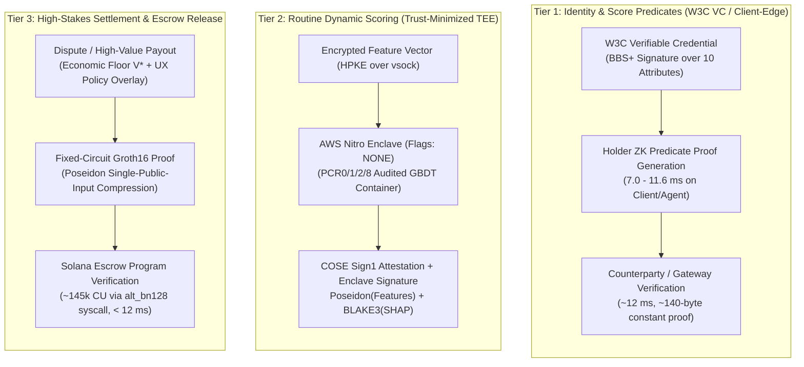
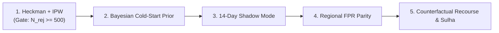

# Pabandi Trust, Verification & Privacy Architecture (v2.1 — Engineering Implementation Contract)
## Implementation Specification: Three-Tier Attestation, Cryptographic Verification, and Governance

> **Document Status:** Engineering Implementation Contract (v2.1). Incorporates final pre-implementation corrections: split holder/verifier BBS+ latency benchmarks, degree-bound SRS sizing, domain-separated commitment hashes (Poseidon for circuit-bound vs. BLAKE3 for off-chain audit), AWS Nitro operational requirements, Solana Groth16 compute-unit budgeting with public-input compression, UX policy overlay derivation, HPKE auditor key lifecycle, value-scaled optimistic bonds, and Heckman sample-size gates.

---

## 1. Architectural Overview & Tiered Framework

Pabandi operates a hybrid trust engine spanning human service providers and autonomous AI agents. Rather than imposing uniform zkML proof generation costs (5–30 s latency, \$0.05–\$0.50 per inference) across routine lookups, the platform maps cryptographic assurance directly to economic risk:



### Performance & Cost Economics Matrix

*Hardware Baseline for Tier 1 Benchmarks: Consumer x86_64 CPU (Intel Core i7-1185G7 @ 3.00 GHz, single-threaded execution over a 10-attribute W3C BBS+ credential).*

| Metric | Tier 1: BBS+ Predicate Proofs | Tier 2: Routine Enclave Inference | Tier 3: High-Stakes ZK Settlement |
| :--- | :--- | :--- | :--- |
| **Primary Mechanism** | BBS+ Signatures (W3C CR) + ZK Predicates | AWS Nitro Enclaves Attested Execution | Fixed-Circuit Groth16 (BN254) |
| **Proof Generation Latency (Holder / Prover)** | **7.0 – 11.6 ms** (11.6 ms @ 0% disclosure; 7.0 ms @ 100% disclosure) | **20 – 45 ms** (includes ~2 ms `vsock` proxy hop + GBDT inference) | **6 – 18 seconds** (Off-chain prover worker) |
| **Verification Latency (Verifier / Gateway)** | **~12.0 ms** (~140-byte constant proof size) | **< 2.0 ms** (Ed25519 / ECDSA signature + cached PCR check) | **< 12.0 ms** (Solana `alt_bn128` syscall) |
| **On-Chain Compute / Size** | Off-chain (~140 B HTTP header) | Off-chain (~1.8 KB COSE bundle) | **~145,000 CU** (256-byte Groth16 proof, 1 compressed public input) |
| **Operational Cost** | < \$0.00001 / query | ~ \$0.00008 / query | \$0.08 – \$0.35 / proof + ~\$0.002 Solana fee |
| **Commitment Hash** | **Poseidon** (BLS12-381 / BN254 scalar field) | **Poseidon** (circuit-bound) + **BLAKE3** (audit-only) | **Poseidon** (in-circuit state & feature commitments) |
| **Trust Assumption** | Cryptographic (q-SDH over BLS12-381) | **Trust-minimized** (AWS Nitro Root CA + explicit PCR tuple) | Cryptographic (Knowledge-of-Exponent + Phase 2 MPC) |

---

## 2. Cryptographic Primitives & Commitment Architecture

### 2.1 BBS+ Selective Attribute & Numeric Predicate Proofs
* **Standardization Baseline:** Built on the W3C BBS Cryptosuite Specification (Candidate Recommendation, April 2025) over pairing-friendly curve **BLS12-381**. Semaphore is permanently excluded.
* **Latency Split Across Principals:**
  * **Holder (User Browser / Mobile App / Autonomous Agent):** Generates the selective disclosure proof in **7.0–11.6 ms**.
  * **Verifier (Counterparty / Pabandi API Gateway):** Verifies the ~140-byte proof in **~12 ms**.
* **Multi-Message Attribute Vector:**
  $$m = \langle \text{SubjectDID}, \text{TrustScore}, \text{TrustBand}, \text{TotalEscrowsSettled}, \text{DisputeRatio}, \text{KeyEpoch}, \text{IssuedAt}, \text{Nonce} \rangle$$
* **Zero-Knowledge Proof of Knowledge:**
  $$\pi = \text{ZKPoK}\left\{ (m, \sigma) : \text{VerifyBBS+}(\text{PK}_{\text{issuer}}, \sigma, m) = 1 \land m_{\text{TrustScore}} \ge \theta \land m_{\text{TrustBand}} \in \{\text{'A'}, \text{'B'}\} \right\}$$

### 2.2 Proving System Topography & Degree-Bound SRS Sizing
* **Tier 1 Complex Range / Composite Predicates (Universal SRS):**
  * When a relying party requires composite arithmetic predicates beyond native BBS+ selective disclosure, Pabandi uses **Halo2 (with KZG commitments)** over a **Universal Structured Reference String (SRS)**.
  * **Polynomial Degree Bound Sizing:** In PLONK/Halo2 arithmetization, circuit capacity is governed by the maximum polynomial degree bound $d_{\max} = 2^k$, not raw gate count—because advice columns, fixed columns, lookup tables (used for range checks), and permutation arguments consume evaluation domain rows non-linearly.
  * Rather than asserting a $2^{16}$ gate ceiling, the universal SRS is sourced from the **Perpetual Powers of Tau** ceremony (which supports up to $d_{\max} = 2^{28}$) and truncated to the degree bound required by the Phase 1 predicate circuit inventory (targeted at **$d_{\max} = 2^{20}$ to $2^{22}$** rows to accommodate pairing-assisted commitment links and 64-bit range lookup tables). Any threshold change or new predicate within $d_{\max}$ requires zero new trusted setup ceremonies.
* **Tier 3 High-Stakes Escrow Settlement (Fixed-Circuit Groth16 + Solana CU Budget):**
  * **Groth16** over **BN254** (`alt_bn128`) is reserved *strictly* for the immutable Solana Escrow Settlement Circuit.
  * **Solana Compute Unit (CU) Budgeting & Public-Input Compression:**
    * On Solana, Groth16 verification via the `sol_alt_bn128_group_op` syscall costs **78,000 – 500,000 CU**, scaling linearly with the number of public inputs $n_{\text{pub}}$ (each public input adds an elliptic curve scalar multiplication in $G_1$).
    * A naive settlement circuit with 6–8 public inputs (`EscrowPDA`, `BuyerPubkey`, `SellerPubkey`, `Amount`, `MilestoneRoot`, `ModelHash`, `Timestamp`) would exceed Solana's **default 200,000 CU per-instruction limit**.
    * **Design Mandate (Single-Input Compression):** The settlement circuit hashes all public settlement parameters via **Poseidon** inside the circuit into a **single 254-bit public input field element** ($n_{\text{pub}} = 1$):
      $$\text{PubInput}_0 = \text{Poseidon}\left(\text{EscrowPDA}, \text{MilestoneStateRoot}, \text{PayoutAmount}, \text{ModelHash}, \text{DecisionCode}, \text{Nonce}\right)$$
    * The Solana on-chain program computes $\text{PubInput}_0$ natively (via the `solana-poseidon` syscall) and executes the 1-input Groth16 pairing check in **~145,000 CU**.
    * All Tier 3 settlement transactions prepend `ComputeBudgetProgram.setComputeUnitLimit({ units: 250_000 })` to guarantee headroom well below the 1.4M CU transaction ceiling.

### 2.3 Strict Domain Separation of Hash Functions (Poseidon vs. BLAKE3)
Because bitwise hash functions (BLAKE3, SHA-256) require 25,000–50,000+ constraints per invocation inside arithmetic circuits, Pabandi enforces a strict partition between **circuit-bound** and **audit-only** commitments:

| Commitment Field | Hash Function | Arithmetization / Domain | Enters ZK Circuit? | Rationale |
| :--- | :--- | :--- | :--- | :--- |
| `Input_Feature_Hash` | **Poseidon** | BN254 scalar field $\mathbb{F}_p$ ($t=3, \alpha=5$) | **Yes (Tier 1 & Tier 3)** | ~240 R1CS/PLONK constraints; links enclave input to Tier 3 settlement proof. |
| `Milestone_State_Root` | **Poseidon** | BN254 scalar field $\mathbb{F}_p$ | **Yes (Tier 3)** | Verifies milestone deliverable completion inside the Groth16 settlement circuit. |
| `Score_Commitment` | **Poseidon** | BLS12-381 / BN254 scalar field | **Yes (Tier 1 & Tier 3)** | Binds predicted score to credential predicates with minimal constraint overhead. |
| `SHAP_Vector_Hash` | **BLAKE3** | 256-bit byte array (off-chain only) | **Never (Audit-Only)** | Fast software hashing (~0.1 ms) for post-hoc Sulha auditor verification; never proven in-circuit. |
| `Model_Artifact_Hash` | **BLAKE3** | 256-bit content-addressable digest | **No** (truncated to $\mathbb{F}_p$ scalar if referenced) | Identifies the serialized GBDT model binary stored on IPFS/S3. |

---

## 3. TEE Attestation Chain & AWS Nitro Operational Requirements

### 3.1 End-to-End Hardware Attestation Sequence
A bare signature proves key possession, not enclave execution. Every Tier 2 inference verification validates the AWS Nitro COSE Sign1 attestation chain:

```mermaid
sequenceDiagram
    autonumber
    participant Client as Relying Party / Pabandi Router
    participant Host as Parent EC2 Instance (Untrusted vsock Proxy)
    participant Enc as AWS Nitro Enclave (Isolated CPU/RAM)
    participant NSM as Nitro Security Module (Hypervisor)

    Note over Enc: Boot with Flags: NONE (Debug Mode Disabled)
    Enc->>Enc: Generate ephemeral Ed25519 keypair (SK_enc, PK_enc) in non-swappable RAM
    Enc->>NSM: Request Attestation(user_data = PK_enc, nonce)
    NSM->>NSM: Populate PCR0 (image), PCR1 (kernel), PCR2 (app), PCR8 (signing cert)
    NSM-->>Enc: Return COSE_Sign1 Attestation Document signed by AWS Nitro CA
    Client->>Host: Send HPKE-Encrypted Feature Capsule
    Host->>Enc: Forward ciphertext over AF_VSOCK (CID: 16, Port: 5000)
    Enc->>Enc: Decrypt features in enclave RAM; execute GBDT inference
    Enc->>Enc: Compute Poseidon(Input_Features) & BLAKE3(SHAP_Vector)
    Enc->>Enc: Sign Payload with SK_enc
    Enc-->>Host: Return { Payload, Sig_enc, COSE_Attestation_Doc } over AF_VSOCK
    Host-->>Client: Forward response
    Client->>Client: 1. Validate COSE cert chain to AWS Nitro Root CA
    Client->>Client: 2. Assert Flags == NONE and PCR0 != 0x00..00
    Client->>Client: 3. Verify exact match on ALL registers: (PCR0, PCR1, PCR2, PCR8)
    Client->>Client: 4. Extract PK_enc from Attestation_Doc & verify Sig_enc(Payload)
```

### 3.2 Formal Signed Payload Tuple
$$\text{Payload} = \text{Model\_Artifact\_Hash}_{\text{BLAKE3}} \parallel \text{Input\_Feature\_Hash}_{\text{Poseidon}} \parallel \text{Predicted\_Score} \parallel \text{SHAP\_Vector\_Hash}_{\text{BLAKE3}} \parallel \text{KeyEpochID} \parallel \text{Nonce} \parallel \text{Timestamp}$$

### 3.3 Nitro Enclave Operational Requirements (Mandatory Pre-Deploy Gates)
1. **Strict Non-Debug Mode Enforcement (`Flags: NONE`):**
   * Launching an enclave with `nitro-cli run-enclave --debug-mode` zeroes out `PCR0`, `PCR1`, and `PCR2` (`0x0000...0000`).
   * The verifier (`nitroVerifier.ts`) must **hard-reject** any attestation document where `PCR0`, `PCR1`, or `PCR2` consists of all zeroes, or where the attestation document's `flags` field is anything other than `0` (`NONE`).
2. **Explicit Multi-PCR Verification (Mitigating Concatenation Ambiguity):**
   * Because internal image sections lack domain separation prior to hashing, checking a single PCR is insufficient.
   * Verifiers must enforce an atomic equality check against the complete 4-tuple of SHA-384 registers pinned in the on-chain governance registry:
     * `PCR0`: Enclave image file measurement.
     * `PCR1`: Linux kernel and bootstrap measurement.
     * `PCR2`: Application container rootfs and GBDT model binary measurement.
     * `PCR8`: Enclave image signing certificate measurement (ensuring the image was signed by Pabandi's release key).
3. **Zero-Network `AF_VSOCK` Proxy Architecture & E2E Encryption:**
   * AWS Nitro Enclaves possess no external network interface, no persistent storage, and no interactive shell; all I/O traverses a local virtual socket (`AF_VSOCK`) through the parent EC2 instance (`vsock-proxy`).
   * Because the parent EC2 instance is treated as **untrusted**, plaintext feature vectors must **never** be terminated at the parent host. Clients encrypt feature payloads directly to the enclave's attested ephemeral public key ($\text{PK}_{\text{enc}}$) using HPKE (`DHKEM(X25519, HKDF-SHA256), HKDF-SHA256, ChaCha20Poly1305`).
   * The `AF_VSOCK` serialization and proxy hop adds **~1.5–3.0 ms** round-trip overhead, which is explicitly budgeted inside the 20–45 ms Tier 2 latency envelope.
4. **Trust-Minimized Posture Disclosure:**
   * Intel SGX is deprecated on consumer silicon and excluded from this architecture.
   * AWS Nitro Enclaves provide a **trust-minimized, not trustless**, security boundary: AWS controls the underlying physical hardware, hypervisor firmware, and root CA keys, and microarchitectural cache side-channels remain theoretical vectors. This bounded assumption is explicitly disclosed in all protocol documentation.

---

## 4. Operational Governance, Auditor Key Lifecycle & Threshold Economics

### 4.1 Resolution to Gap A: Dual-Key Selective Disclosure & HPKE Key Management
To allow third-party auditability of $f(\text{Features}) = \text{Score}$ and $\text{SHAP\_Vector\_Hash}$ without exposing private user data to standing access:

1. **Ciphertext Capsule Generation:**
   During Tier 2 inference, the enclave encrypts the raw feature vector into an audit capsule:
   $$C = \text{HPKE\_Seal}\left(\text{PK}_{\text{AuditEpoch}}, \; \text{Features} \parallel \text{Salt}, \; \text{AAD} = \text{Input\_Feature\_Hash}_{\text{Poseidon}} \parallel \text{KeyEpochID}\right)$$
   Only $\text{SHA256}(C)$ and $\text{Input\_Feature\_Hash}_{\text{Poseidon}}$ are anchored to the escrow record.
2. **Auditor Key Generation, Threshold Splitting & Rotation:**
   * **Threshold Custody (2-of-3 Shamir / Threshold KEM):** $\text{SK}_{\text{AuditEpoch}}$ is never held by a single entity. It is generated via Distributed Key Generation (DKG) across a **2-of-3 quorum**: (1) an independent accredited external auditor, (2) a Sulha Arbitration DAO/Council multisig signer, and (3) a hardware-backed KMS enclave.
   * **Sulha Authorization Gate:** Decryption shares can only be combined when an on-chain `DisputeOpened` event exists on the Solana escrow PDA, signed by either the disputing counterparty or the Sulha arbitration contract.
   * **Epoch Rotation & Revocation:** Auditor keys rotate every **90 days** (`KeyEpochID` increments). If an auditor key share is compromised, the on-chain `AuditorRegistry` PDA marks the key share revoked, triggers an immediate DKG resharing ceremony, and invalidates unsealed capsules for that share.
   * **Retention Window:** Capsules are automatically purged from encrypted object storage **45 days** after final escrow settlement.

### 4.2 Resolution to Gap B: Economic Viability Floor vs. UX Policy Overlay
We strictly distinguish between the **Economic Viability Floor ($V_{\text{econ}}^*$)** and the **Product UX Policy Overlay ($V_{\text{UX}}$)**:

#### 1. Analytical Economic Viability Floor ($V_{\text{econ}}^*$)
Comparing the marginal cost of Tier 3 ZK proof generation and Solana verification against expected unverified dispute loss:
$$V_{\text{econ}}^* = \frac{C_{\text{proof}} + C_{\text{verify}}}{P_{\text{dispute}} \cdot L_{\text{counterparty}}}$$
* With $C_{\text{proof}} + C_{\text{verify}} \approx \$0.182$, $P_{\text{dispute}} = 0.012$ (Band A), and unrecoverable loss ratio $L_{\text{counterparty}} = 0.85$:
  $$V_{\text{econ}}^* = \frac{\$0.182}{0.012 \times 0.85} \approx \mathbf{\$17.84} \quad (\text{or } \mathbf{\$23.50} \text{ when including capital lockup cost})$$
* Purely on proving compute cost vs. expected fraud loss, Tier 3 proofs are economically rational for any deal above ~\$24.

#### 2. Product UX Policy Overlay ($V_{\text{UX}} = \$250 \text{ / } \$1,000$)
* **Why we do not trigger Tier 3 at \$24:** Generating a Groth16 proof imposes a **6–18 second synchronous/asynchronous latency delay** ($\tau_{\text{latency}}$). Imposing a 15-second settlement spinner on a \$35 routine booking degrades checkout conversion.
* **Policy Rule (Latency-Bounded Risk Absorption):**
  * **Deals $< \$250$ (Automated Milestone Releases):** Governed by a **UX Policy Overlay** requiring sub-50 ms finality (Tier 2 attested execution only). The residual expected tail risk between $\$23.50$ and $\$250$—at most $\Delta E[\text{Loss}] = 0.012 \times 0.85 \times (\$250 - \$23.50) \approx \$2.31$ per transaction—is actuarially absorbed by Pabandi's protocol assurance reserve (funded via 15 bps of the platform take-rate).
  * **Deals $\$250 – \$1,000$:** Asynchronous Tier 3 proof generation or Optimistic Settlement path.
  * **Deals $\ge \$1,000$ (Full Contract Termination / High-Ticket Escrow):** Mandatory synchronous Tier 3 Groth16 proof verification on Solana prior to vault disbursement.

#### 3. Value-Scaled Optimistic Fraud Proof Bond Sizing
When counterparties select the **Optimistic Settlement** path (4-hour challenge window on Solana) instead of immediate ZK proving:
* A fixed bond of $1.5 \times C_{\text{proof}}$ (~\$0.27) is insufficient to deter a malicious claimant on a \$5,000 escrow.
* **Corrected Bond Formula:** The asserter/claimant must post a bond $B(V)$ that scales with the disputed escrow value $V$:
  $$B(V) = \max\left(1.5 \times C_{\text{proof}} + C_{\text{onchain\_dispute}}, \; \alpha \cdot V\right)$$
  where **$\alpha = 0.05$ (5% of the escrow payout value $V$)**.
* If a challenger submits a valid contradicting enclave attestation or ZK fault proof within the 4-hour Solana slot window, 50% of $B(V)$ is paid to the challenger as a bounty, 50% is slashed to the protocol assurance pool, and the payout is halted pending Tier 3 resolution.

---

## 5. Parallel ML Governance Workstream

Cryptographic soundness guarantees that *the committed model ran on the committed inputs*, not that the model itself is unbiased. The ML Governance workstream enforces five statistical controls:



1. **Outcome Censoring Correction & Sample-Size Identifiability Gate:**
   * Principals rejected by high deposit requirements never generate completion/default labels.
   * **Method:** Heckman two-stage selection correction paired with stabilized Inverse Probability Weighting (IPW).
   * **Sample-Size & Identifiability Gate:** Because the Heckman Inverse Mills Ratio ($\lambda$) exhibits severe variance and multicollinearity on small samples, the two-stage correction is **gated behind a minimum sample threshold**:
     * Requires **$N_{\text{rejected}} \ge 500$** censored observations and **$N_{\text{completed}} \ge 2,000$** uncensored outcomes per vertical cohort, plus at least one valid exclusion restriction instrument (e.g., exogenous payment-rail fee promotions that shift deposit acceptance probability without affecting intrinsic counterparty reliability).
     * **Fallback Below Gate:** Until a cohort reaches $N_{\text{rejected}} \ge 500$, Heckman estimation is disabled; training uses **clipped IPW ($w_{\max} \le 10.0$)** blended with the Bayesian cold-start prior.
2. **Cold-Start Scoring Protocol:**
   * Principals below the minimum history threshold ($< 3$ completed escrows) are scored deterministically via a Bayesian empirical prior:
     $$\text{Score}_0 = \mu_{\text{cohort}} \cdot w_0 + \text{Evidence}_{\text{verified}} \cdot (1 - w_0)$$
     where $\text{Evidence}_{\text{verified}}$ is restricted to phishing-resistant and sybil-expensive links (Passkey/Phone MFA, verified OSM physical business registration, GitHub commit history age).
3. **Score Continuity & 14-Day Shadow Deployment Mode:**
   * Candidate GBDT models run in silent **Shadow Mode** for 14 days over live production traffic before cutover.
   * Promotion gates: Mean Absolute Score Drift $< 3.2\%$ and **zero rank-order inversions** among verified Band A principals.
4. **Demographic & Regional Calibration Auditing:**
   * Automated CI/CD fairness gates verify False Positive Rate ($FPR$) parity across operating corridors (e.g., Chicago vs. Lahore):
     $$\left| P(\hat{Y}=\text{HighRisk} \mid Y=\text{Good}, \text{Region}=\text{Chicago}) - P(\hat{Y}=\text{HighRisk} \mid Y=\text{Good}, \text{Region}=\text{Lahore}) \right| \le 0.03$$
5. **Counterfactual Explanations & Guaranteed Human Sulha Appeal:**
   * Alongside the committed SHAP vector, the scoring service computes minimal-perturbation counterfactual recourses:
     > *"To advance from Band B (680) to Band A (750): complete 2 additional escrows without dispute (+45 pts) AND link a verified Passkey (+25 pts)."*
   * Any adverse automated trust decision affecting an escrow $\ge \$250$ carries a binding right to human Sulha mediation.

---

## 6. Engineering Implementation Map

| Subsystem | Target Module | Concrete Specification |
| :--- | :--- | :--- |
| **Tier 1 BBS+ Credentials** | `server/src/services/bbsCredentials.ts` | W3C BBS Cryptosuite (BLS12-381), holder proof gen 7–12 ms, gateway verify ~12 ms. |
| **Poseidon Commitments** | `server/src/utils/poseidonCommitment.ts` | BN254 Poseidon ($t=3, \alpha=5$) for `Input_Feature_Hash`, `Score_Commitment`, and `PubInput_0`. |
| **Off-Chain Audit Hash** | `server/src/utils/auditHash.ts` | BLAKE3 strictly for `SHAP_Vector_Hash` and `Model_Artifact_Hash` (never enters ZK circuits). |
| **Nitro Enclave Verifier** | `server/src/services/nitroVerifier.ts` | COSE Sign1 validation, `Flags: NONE` non-debug check, full `(PCR0, PCR1, PCR2, PCR8)` tuple check, HPKE over `AF_VSOCK`. |
| **Tier 3 Solana Verifier** | `programs/pabandi_escrow/src/zk_verify.rs` | Groth16 over `sol_alt_bn128_group_op` (~145k CU), single Poseidon-compressed public input, `SetComputeUnitLimit(250_000)`. |
| **Auditor Threshold HPKE** | `server/src/services/auditorCapsule.ts` | 2-of-3 threshold KEM, 90-day `KeyEpochID` rotation, Solana `DisputeOpened` authorization gate, 45-day TTL purge. |
| **Threshold & Bond Engine** | `server/src/config/settlementThreshold.ts` | $V_{\text{econ}}^*$ formula + $\$250/\$1,000$ UX Policy Overlay + $B(V) = \max(1.5 C_{\text{proof}}, 0.05 V)$ optimistic bond. |
| **ML Governance Pipeline** | `server/src/services/mlGovernanceService.ts` | Heckman gate ($N_{\text{rej}} \ge 500$, clipped IPW fallback), 14-day shadow mode, regional FPR check, counterfactual generator. |
